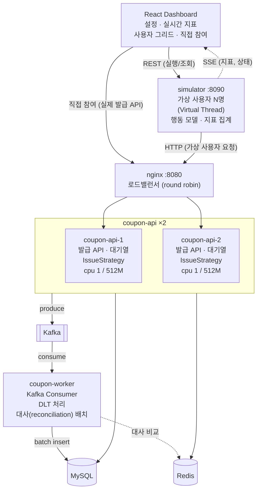
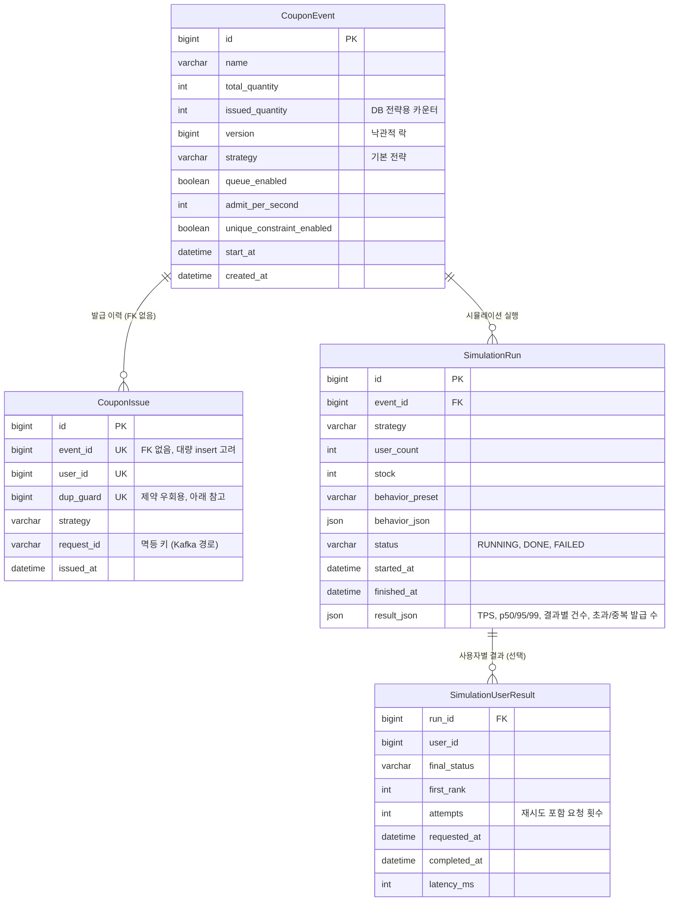

# 02. 아키텍처

## 1. 설계 원칙

### 1.1 부하는 서버가 만들고, 브라우저는 지켜본다

브라우저에서 사용자 10,000명의 요청을 직접 보내는 방식은 쓸 수 없습니다.

- 브라우저는 도메인당 동시 연결이 HTTP/1.1 기준 6개 정도로 제한되어 있어서 요청이 **브라우저 안에서 줄을 섭니다**. 서버에서 일어나는 경쟁을 재현할 수 없습니다.
- 수천 개의 Promise와 렌더링 때문에 탭이 먼저 멈춥니다.

그래서 가상 사용자는 **별도 프로세스인 Simulator**가 만들고, React 대시보드는 결과를 SSE로 받아서 보여주기만 합니다.

### 1.2 실무 구성을 그대로, 크기만 줄인다

실무 구성을 그대로 두고 **서버 자원을 줄여서** 같은 병목을 재현합니다.

- API 서버는 로드밸런서(nginx) 뒤에 **2대**를 띄우고, Kafka Consumer는 **별도 워커**로 분리합니다.
- 부하 생성기(Simulator)는 API와 다른 프로세스·컨테이너에서 돌립니다.
- 컨테이너마다 CPU, 메모리, DB 커넥션 풀을 작게 제한합니다. 그러면 사용자 수천 명만으로도 커넥션 풀 고갈, 락 대기, GC 같은 실무 병목이 나타납니다.

### 1.3 "직접 참여" 모드

시뮬레이션이 도는 중에 브라우저 사용자 한 명이 **nginx를 통해 실제 API로** 발급을 시도합니다.
가상 사용자와 같은 Redis 대기열에 들어가기 때문에, 가상 사용자들 뒤에 줄을 서서 진짜 경쟁 결과(성공/매진)를 받습니다.

## 2. 전체 구성도



| 구성요소 | 역할 |
|---|---|
| **simulator** | 시뮬레이션 실행/중단 API, 가상 사용자 생성, 클라이언트 측 지표(지연시간, TPS) 집계, SSE 송출 |
| **nginx** | 두 API 인스턴스로 요청 분산. 실무의 L7 로드밸런서 역할 |
| **coupon-api** ×2 | 쿠폰 이벤트, 발급 API, 대기열, 발급 전략. 상태는 모두 Redis/DB에 두고 인스턴스 자체는 상태 없음 |
| **coupon-worker** | Kafka Consumer(DB 저장), DLT 재처리, Redis와 DB를 맞추는 대사 배치 |

## 3. 저장소 구조 (모노레포, Gradle 멀티모듈)

```
fcfs-coupon-simulator/
├── backend/
│   ├── common/          # 도메인 모델, DTO, Redis 키, Kafka 메시지 정의
│   ├── coupon-api/      # 발급 API, 대기열(queue), IssueStrategy 구현체
│   ├── coupon-worker/   # Kafka Consumer, DLT 처리, 대사 배치
│   └── simulator/       # 시뮬레이션 실행기, 가상 사용자 행동 모델, 지표 집계, SSE
├── frontend/            # React + Vite + TS
├── infra/
│   ├── docker-compose.yml       # 인프라: mysql, redis, kafka
│   ├── docker-compose.app.yml   # 앱: nginx, coupon-api ×2, coupon-worker, simulator (자원 제한 포함)
│   └── nginx/nginx.conf
├── loadtest/            # (확장) k6 스크립트
└── docs/
```

### 실행 모드 두 가지

| 모드 | 방법 | 용도 |
|---|---|---|
| **개발 모드** | 인프라만 Docker, 앱은 IDE에서 실행 (API 1대) | 기능 개발, 디버깅 |
| **실측 모드** | `docker-compose.yml` + `docker-compose.app.yml` 모두 Docker로 실행 | 전략 비교, 수치 측정, 시연 |

수치 비교는 항상 **실측 모드**에서 합니다. 개발 모드의 수치는 IDE와 디버거 영향을 받기 때문에 비교 대상이 아닙니다.

## 4. 도메인 모델



`CouponIssue`의 `UK` 세 컬럼이 합쳐서 `UNIQUE(event_id, user_id, dup_guard)` 제약 하나를 이룹니다. 발급의 최후 방어선입니다.

> 중복 방지 제약은 이벤트마다 **끌 수 있게** 만듭니다(`unique_constraint_enabled`).
> 제약이 켜져 있으면 중복 발급이 DB 예외로 가려져서, "락 없는 구현"이 어떻게 깨지는지 보이지 않기 때문입니다.
> DB 제약은 이벤트별로 켜고 끌 수 없어서, 제약을 끈 이벤트는 발급 행마다 다른 `dup_guard` 값을 넣어 우회합니다. 켠 이벤트는 항상 0이라 `(event_id, user_id)` 중복이 막힙니다.
>
> 발급 한도는 **1인 1매로 고정**합니다. 한도를 늘리면 위의 제약 방식과 맞지 않고, 선착순 쿠폰은 대부분 1인 1매이기 때문입니다.

## 5. Redis 키 설계

| 키 | 타입 | 용도 |
|---|---|---|
| `coupon:{eventId}:stock` | String(int) | 남은 재고 (DECR) |
| `coupon:{eventId}:issued` | Set | 발급받은 userId (중복 방지) |
| `queue:{eventId}:waiting` | Sorted Set | 대기열, score = 진입 시각(ns) |
| `queue:{eventId}:active` | Sorted Set | 입장한 사용자, score = 토큰 만료 시각 |
| `lock:coupon:{eventId}` | (Redisson) | 분산 락 전략용 |

- `{eventId}` 중괄호는 Redis Cluster의 **해시태그**입니다. 같은 이벤트의 키가 같은 노드에 모이기 때문에, 나중에 클러스터로 바꿔도 여러 키를 다루는 Lua 스크립트가 그대로 동작합니다.
- 입장 시각과 만료 시각은 서버 2대 사이의 시계 차이를 피하기 위해 Redis `TIME` 기준으로 기록합니다.
- Redis는 `appendonly yes`(AOF)로 띄워서 재시작해도 재고와 발급 Set이 남게 합니다.

## 6. Kafka

| 토픽 | 키 | 값 | 비고 |
|---|---|---|---|
| `coupon-issue` | eventId | `{requestId, eventId, userId, requestedAt}` | 파티션 3개. 같은 이벤트는 같은 파티션으로 가서 순서가 보장됨 |
| `coupon-issue.DLT` | eventId | 실패 메시지 + 실패 사유 | 재시도를 다 쓴 메시지 |

Producer/Consumer 설정과 실패 처리는 [03. 발급 전략 - 정합성 보장 장치](03-issuance-strategies.md#정합성-보장-장치)에 정리했습니다.

## 7. 인프라와 자원 제한 (실측 모드)

| 서비스 | 이미지 | 포트 | 자원 제한 | 주요 설정 |
|---|---|---|---|---|
| mysql | `mysql:8.4` | 3306 | cpu 1, 1G | `max_connections=100` |
| redis | `redis:7.4` | 6379 | cpu 0.5, 256M | `appendonly yes` |
| kafka | `apache/kafka:3.8.0` (KRaft, 단일 브로커) | 9092 | cpu 1, 1G | |
| nginx | `nginx:1.27` | 8080 | cpu 0.5, 128M | round robin, keepalive |
| coupon-api ×2 | 직접 빌드 | (내부) | 각 cpu 1, 512M | HikariCP `maximumPoolSize=10`, Virtual Thread |
| coupon-worker | 직접 빌드 | (내부) | cpu 0.5, 384M | |
| simulator | 직접 빌드 | 8090 | cpu 2, 1G | |
| kafka-ui (선택) | `provectuslabs/kafka-ui` | 8085 | | |

- 위 수치는 출발점입니다. 노트북 코어 수에 맞춰 조정하되, **전체 합이 호스트 코어 수를 넘지 않게** 해야 컨테이너끼리 CPU를 뺏고 빼앗는 왜곡이 줄어듭니다.
- simulator도 같은 호스트에서 돌기 때문에 절대 수치보다 **전략 간 상대 비교**에 의미를 둡니다. 부하 생성기를 다른 장비로 옮기는 것은 [확장 백로그](07-backlog.md)에 있습니다.

## 8. 측정 방식

- **클라이언트 측 지표** (simulator가 측정)
  - 지연시간: 요청 직전과 응답 직후를 `System.nanoTime()`으로 재고, HdrHistogram으로 p50/p95/p99 계산
  - TPS: 1초 단위 완료 건수
  - 재시도 횟수, 이탈 수 (행동 모델 기준)
- **서버 측 지표** (coupon-api, coupon-worker의 Actuator)
  - HikariCP 커넥션 대기 시간과 활성 커넥션 수, Kafka Consumer lag
  - 처음에는 대시보드에 핵심 몇 개만 표시하고, Prometheus/Grafana 연동은 [확장 백로그](07-backlog.md)에서 진행
- **정합성 판정** (실행 종료 후 DB 쿼리)
  - 초과 발급 = `count(coupon_issue where event_id=?) - total_quantity` (0보다 크면 실패)
  - 중복 발급 = `count(*) - count(distinct user_id)`
  - 비동기 전략은 대사 배치까지 끝난 뒤에 판정
- **비동기 전략**: "API 응답 완료"와 "DB 반영 완료" 시점을 따로 기록하고, 그 차이(= 반영 지연)를 함께 표시
