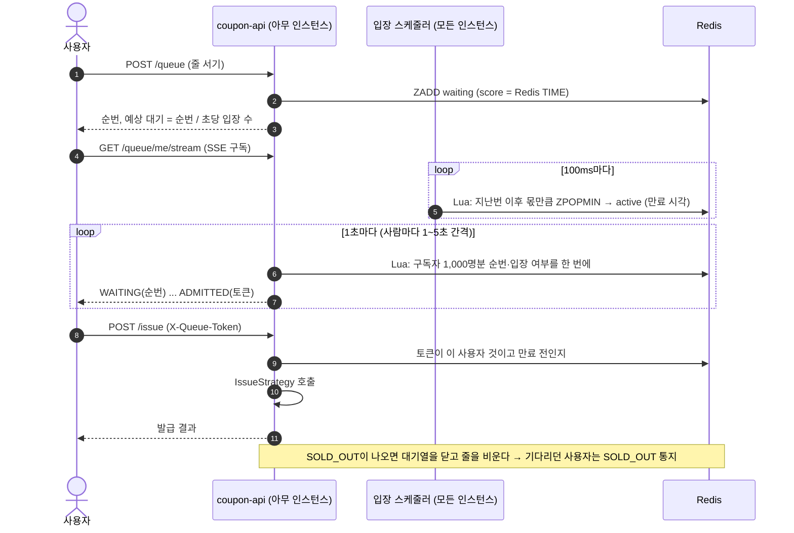

# 03. 발급 전략

모든 전략은 하나의 인터페이스로 구현하고, 이벤트 설정이나 요청 파라미터로 바꿔 끼웁니다.

```java
public interface IssueStrategy {
    StrategyType type();
    IssueResult issue(long eventId, long userId);   // ISSUED | SOLD_OUT | DUPLICATE | ACCEPTED(비동기) | ERROR
}
```

## 전략 목록

| # | 전략 | 핵심 아이디어 | 예상 결과 |
|---|---|---|---|
| 1 | `NAIVE` | 조회 → 확인 → 증가, 락 없음 | ❌ 초과 발급, 중복 발급 발생 (반면교사용) |
| 2 | `SYNCHRONIZED` | Java `synchronized` | ⚠️ 개발 모드(API 1대)에서는 통과. 실측 모드(API 2대)에서는 깨짐 |
| 3 | `DB_PESSIMISTIC` | `SELECT ... FOR UPDATE` | ✅ 정합성 보장. 행 락 경합으로 TPS 낮음 |
| 4 | `DB_OPTIMISTIC` | `@Version` + 재시도 | ✅ 정합성 보장. 경합이 심하면 재시도가 폭증해 오히려 느림 |
| 5 | `REDIS_LOCK` | Redisson 분산 락 안에서 DB 처리 | ✅ 정합성 보장. 다중 인스턴스 OK. 락 대기가 병목 |
| 6 | `REDIS_ATOMIC` | Lua 스크립트로 중복 체크와 재고 차감을 원자적으로, DB 저장은 동기 | ✅ 정합성 보장. 빠름 |
| 7 | `REDIS_KAFKA` | Redis에서 원자적으로 판정, Kafka로 넘기고 바로 응답, Consumer가 DB 저장 | ✅ 판정은 정확. 응답 가장 빠름. DB 반영은 늦음(최종 일관성) |

그리고 어느 전략에든 **대기열(Waiting Queue)** 을 앞단에 붙일 수 있습니다(`queueEnabled`).

---

## 1. NAIVE

```java
CouponEvent e = repo.findById(eventId);
if (issueRepo.existsByEventIdAndUserId(eventId, userId)) return DUPLICATE;
if (e.getIssuedQuantity() >= e.getTotalQuantity()) return SOLD_OUT;
e.increase();                       // issued_quantity + 1
issueRepo.save(new CouponIssue(eventId, userId));
```

여러 스레드가 동시에 "재고 있음"을 읽고 모두 통과합니다(Race condition, Lost update).

초과 발급 규모는 대략 **재고 × DB 커넥션 수**입니다. 커넥션 10개가 거의 같은 카운터 값을 읽고 각자 "읽은 값 + 1"을 덮어쓰기 때문에, 발급 10건마다 카운터가 1씩만 올라갑니다. 그래서 카운터가 100에 닿을 때까지 1,000건 가까이 발급됩니다(Phase 1·2 실측: 재고 100에 991~1,000장).
**이 전략에서 초과 발급이 실제로 나는 걸 보여주는 것이 프로젝트의 출발점입니다.**

## 2. SYNCHRONIZED

`synchronized` 메서드로 감쌉니다. 주의할 점이 있습니다. `@Transactional`과 같이 쓰면 **락이 풀린 다음에 커밋**되기 때문에 여전히 깨질 수 있습니다.
트랜잭션 바깥에서 락을 잡아야 합니다. 이 함정을 직접 보여주는 것도 학습 포인트입니다.

또 `synchronized`는 JVM 하나 안에서만 유효합니다. 실측 모드는 API를 2대 띄우기 때문에, 같은 코드가 **개발 모드에서는 통과하고 실측 모드에서는 초과 발급**이 나는 모습을 그대로 볼 수 있습니다.

## 3. DB_PESSIMISTIC

```java
@Lock(LockModeType.PESSIMISTIC_WRITE)
@Query("select e from CouponEvent e where e.id = :id")
Optional<CouponEvent> findByIdForUpdate(long id);
```

모든 요청이 이벤트 행 하나에 몰리기 때문에 사실상 직렬 처리됩니다. 커넥션 풀 고갈과 락 대기 타임아웃을 관찰할 수 있습니다.

## 4. DB_OPTIMISTIC

`@Version` 충돌(`ObjectOptimisticLockingFailureException`)이 나면 재시도합니다(최대 N회, 백오프).
지표에 **재시도 횟수**를 따로 집계해서, 경합이 심할 때 낙관적 락이 왜 불리한지 보여줍니다.

## 5. REDIS_LOCK

```java
RLock lock = redisson.getLock("lock:coupon:{" + eventId + "}");
if (!lock.tryLock(waitMs, MILLISECONDS)) return ERROR(LOCK_TIMEOUT);   // lease를 주지 않으면 watchdog이 자동 연장
try { /* NAIVE와 같은 로직 (트랜잭션은 락 안에서 시작하고 끝냄) */ }
finally { if (lock.isHeldByCurrentThread()) lock.unlock(); }
```

- 대기 시간(`coupon.issue.redis-lock.wait-ms`, 기본 10초)을 넘기면 `LOCK_TIMEOUT`. 5,000명이 락 하나를 기다리면 대부분이 여기서 실패합니다.
- **락 유지 시간(lease)을 고정하면 안 됩니다.** 처음에 lease를 5초로 두었는데, 메모리 압박으로 처리가 5초를 넘긴 순간 락이 먼저 풀려 다른 요청이 들어왔고 **초과 발급 1건**이 났습니다. 지금은 Redisson watchdog(락을 잡은 스레드가 살아 있는 동안 자동 연장, 인스턴스가 죽으면 30초 뒤 해제)을 씁니다.
- 분산 락은 "Redis가 정확히 한 명만 통과시킨다"는 가정 위에 있어서, 락이 풀리는 시점과 실제 처리 시간이 어긋나면 깨집니다. `REDIS_ATOMIC`처럼 판정 자체를 원자적으로 만드는 쪽이 더 단단합니다.

## 6. REDIS_ATOMIC (Lua)

```lua
-- KEYS[1] = coupon:{id}:stock, KEYS[2] = coupon:{id}:issued, ARGV[1] = userId
local stock = redis.call('GET', KEYS[1])
if not stock then return -2 end                                        -- 재고 키 없음 → DB 기준으로 다시 채움
if redis.call('SISMEMBER', KEYS[2], ARGV[1]) == 1 then return -1 end  -- DUPLICATE
if tonumber(stock) <= 0 then return 0 end                              -- SOLD_OUT
redis.call('DECR', KEYS[1])
redis.call('SADD', KEYS[2], ARGV[1])
return 1                                                               -- OK
```

- 재고 키는 이벤트를 만들거나 초기화할 때 총 수량으로 채웁니다. Redis가 재시작되어 키가 없으면(`-2`) DB의 발급 이력으로 남은 재고와 발급 Set을 다시 채운 뒤 판정합니다(F6).
- 판정에 통과하면 DB에 동기로 저장합니다. 락이 없고 이벤트 행(DB 카운터)도 건드리지 않아서 핫 로우 경합이 없습니다. 그래서 DB 카운터(`issued_quantity`)는 0으로 남고, 남은 재고는 Redis에서 봅니다.
- DB 저장이 실패하면 Redis를 되돌립니다(`INCR` + `SREM`, F2). DB의 UNIQUE 제약에 걸리면(이미 발급된 사용자) 재고만 돌려주고 발급 Set은 그대로 둡니다.
- 스크립트는 `coupon-api/src/main/resources/scripts/`에 있습니다.

### 멱등 키 (`X-Request-Id`)

클라이언트가 타임아웃으로 포기했지만 서버는 발급을 끝낸 경우가 있습니다. 이때 재시도가 `DUPLICATE`를 받으면 사용자는 "이미 받았다"는 이상한 화면을 봅니다. 그래서 재시도는 같은 요청 id를 쓰고, 서버는 중복으로 판정된 요청이 같은 id로 이미 발급된 것이면 `ISSUED`(`IDEMPOTENT_REPLAY`)를 돌려줍니다. 모든 전략에 공통입니다.

## 7. REDIS_KAFKA

1. Lua로 판정 (6번과 같음). 요청마다 `requestId`(UUID)를 만들어 멱등 키로 씁니다.
2. 통과하면 `coupon-issue` 토픽으로 produce하고, **브로커 ack를 받은 뒤에** `ACCEPTED` 응답
3. coupon-worker의 Consumer가 배치로 DB insert (멱등)

`ACCEPTED`는 "발급 확정, DB 반영은 곧"이라는 뜻입니다. Redis 판정과 Kafka 저장이 둘 다 끝났기 때문에 사용자에게 성공으로 보여줘도 되고, DB는 조금 늦게 따라옵니다(최종 일관성).

지표: API 응답 지연(매우 낮음), **Consumer lag**, **DB 반영 완료까지 걸린 시간**.
"사용자는 성공을 받았는데 DB에는 아직 없다"는 구간을 대시보드에서 볼 수 있게 합니다.

---

## 정합성 보장 장치

Redis, Kafka, DB를 함께 쓰면 **세 곳의 상태가 어긋나는 순간**이 생깁니다. 실무에서 가장 어려운 부분이라 단계마다 무엇이 실패할 수 있고 어떻게 처리하는지 정해 둡니다.

### 실패 지점별 처리

| # | 실패 지점 | 결과 | 처리 |
|---|---|---|---|
| F1 | Lua 실행 중 Redis 장애 | 판정 자체가 안 됨 | `ERROR` 응답. 상태 변화 없음 |
| F2 | Lua 통과 후 DB 저장 실패 (`REDIS_ATOMIC`) | Redis는 차감, DB는 없음 | Redis 보상(`INCR` + `SREM`) 후 `ERROR` 응답 |
| F3 | Lua 통과 후 Kafka 전송 실패·타임아웃 (`REDIS_KAFKA`) | Redis는 차감, 메시지 없음 | Redis 보상 후 `ERROR` 응답. 보상까지 실패하면 대사 배치가 바로잡음 |
| F4 | Consumer의 DB 저장 실패 | 메시지는 있음, DB는 없음 | 백오프 재시도 3회 → DLT로 이동 → DLT 재처리 |
| F5 | Consumer가 같은 메시지를 두 번 처리 (리밸런싱, 재시작) | 같은 insert가 중복 시도됨 | `UNIQUE` 제약 + `INSERT IGNORE`로 멱등 처리 |
| F6 | Redis 재시작으로 키 유실 | 재고와 발급 Set이 사라짐 | AOF로 예방. 그래도 유실되면 DB 기준으로 재적재 |

### Kafka 설정

| 구분 | 설정 | 이유 |
|---|---|---|
| Producer | `enable.idempotence=true`, `acks=all` | 재전송해도 브로커에 중복 저장되지 않음 |
| Producer | 전송 타임아웃(`delivery.timeout.ms`) 짧게 (예: 3초) | 사용자 응답이 오래 묶이지 않게 하고, 실패하면 F3 처리 |
| Consumer | 자동 커밋 끔, **DB 커밋 후 오프셋 커밋** | 처리하지 않은 메시지를 처리한 것으로 넘기지 않음 |
| Consumer | 배치 리스너 (예: 최대 500건) | insert를 묶어서 DB 부하 감소 |
| 에러 처리 | `DefaultErrorHandler` + 백오프 재시도 3회 → `coupon-issue.DLT` | 독성 메시지 하나가 파티션 전체를 막지 않게 함 |

### 대사(reconciliation) 배치

coupon-worker가 주기적으로(예: 이벤트 진행 중 30초마다, 종료 후 1회) Redis와 DB를 비교해서 맞춥니다.

| 상황 | 의미 | 처리 |
|---|---|---|
| Redis 발급 Set에만 있고 DB에 없음 | Kafka 처리 중이거나, F3·F4 실패 | Consumer lag이 0이고 DLT에도 없으면 유실로 판단 → DB에 보정 insert (또는 Redis 보상) |
| DB에만 있고 Redis에 없음 | Redis 키 유실(F6) 또는 버그 | Redis Set에 다시 추가하고 경고 로그 |
| `재고 키 ≠ 총 수량 - Set 크기` | 보상 처리 일부 실패 | 재고 키를 다시 계산해서 덮어씀 |

대사 결과(보정 건수)는 시뮬레이션 결과에 함께 기록해서, **장애가 있었을 때 무엇이 어떻게 복구됐는지** 대시보드에서 확인할 수 있게 합니다.

---

## 대기열 (Waiting Queue)

발급 전략과 별개로 앞단에 붙는 **유량 제어** 계층입니다. 정합성이 아니라 **서버 보호와 사용자 경험**을 위한 것입니다. 1인 1매와 재고는 여전히 발급 전략이 지킵니다.



### 입장 스케줄러: 토큰 버킷 + Redis 시계
- API 인스턴스 **모두**가 100ms마다 같은 Lua 스크립트를 부릅니다. 스크립트가 Redis `TIME`으로 "마지막 입장 기준 시각 이후 몇 명 몫이 쌓였는지"를 계산해서 그만큼만 꺼내므로, 몇 대가 몇 번 부르든 합쳐서 초당 K명입니다. 리더 선출이 필요 없고, 한 대가 죽어도 남은 인스턴스가 계속 입장시킵니다.
- 몫은 최대 1초치까지만 쌓이고, 줄이 비어 있는 동안에는 쌓이지 않습니다. 그래야 줄이 다시 생겼을 때 한꺼번에 몰려 들어오지 않습니다.
- 순번(score)은 Redis 시계 기준 진입 시각(µs)입니다. API 서버 두 대의 시계가 조금 달라도 순서가 뒤집히지 않습니다.

### 순번 알림: SSE와 폴링
- **SSE(push)**: 인스턴스마다 자기에게 연결된 구독자의 순번을 Lua 한 번(1,000명 단위)으로 읽어서 보냅니다. 사용자마다 따로 묻는 폴링보다 HTTP 요청과 Redis 왕복이 훨씬 적습니다. 대신 연결을 계속 잡고 있어서 **연결 수와 메모리**가 비용입니다(Tomcat에서 연결 하나에 힙 약 100KB).
- 1만 명 모두에게 1초마다 보내면 그것만으로 API CPU를 다 써서 정작 발급이 느려졌습니다. 그래서 **곧 입장할 사람은 자주, 한참 남은 사람은 드물게** 보냅니다(예상 대기 시간의 10%, 1~5초). 입장·매진처럼 대기가 끝나는 상태는 바로 보냅니다. 5초 간격은 프록시가 조용한 연결을 끊지 않게 하는 heartbeat 역할도 합니다.
- **폴링**: 사용자가 `GET /queue/me`를 주기적으로 부릅니다. 구현은 단순하지만 1만 명이 1초마다 물으면 초당 1만 건이 됩니다. 실측에서 API CPU가 100%에 붙고 순번 확인 요청 7,787건이 실패했습니다 ([06 Phase 5 결과](06-roadmap.md#phase-5-대기열)). 실무의 대기열 서비스가 폴링을 쓸 때는 다음 확인 시점을 서버가 순번에 따라 정해 줍니다.

### 입장 토큰
- 입장하면 처음 상태를 조회할 때 토큰을 만듭니다(`sha1(무작위 값 + userId)`, 이미 있으면 그대로). 발급 요청은 `X-Queue-Token`이 그 사용자 토큰이고 만료 전(기본 30초)이어야 전략까지 갑니다. 아니면 `403 NOT_ADMITTED`.
- 토큰은 유효 시간 안에는 **다시 쓸 수 있게** 두었습니다. 발급 응답을 못 받은 클라이언트가 같은 토큰과 같은 `X-Request-Id`로 재시도하면 멱등 처리로 같은 결과를 받게 하기 위해서입니다. 1인 1매는 토큰이 아니라 발급 전략이 지키므로, 토큰을 다시 써도 두 장을 받을 수는 없습니다.
- 지금은 토큰을 Redis에서 확인합니다. 서명된 토큰으로 Redis 조회 없이 검증하고 대기열을 별도 서비스로 떼는 것은 [07 B1](07-backlog.md#b1-서명된-입장-토큰--대기열-분리-)에 있습니다.

### 매진되면 줄을 닫는다
- 대기열을 쓰는 이벤트에서 발급 결과가 `SOLD_OUT`이면 대기열을 닫고 줄을 비웁니다. 기다려도 받을 수 없는 사용자를 계속 세워 두지 않기 위해서입니다. 기다리던 사용자는 다음 순번 알림에서 `SOLD_OUT`을 받고, 새로 오는 사용자도 줄 서기에서 바로 `SOLD_OUT`을 받습니다.
- 그래서 1만 명 중 재고 3,000이면 나머지 7,000명은 **발급 API까지 오지 않고** 줄에서 끝납니다. 대기열이 없을 때는 1만 명이 모두 발급 API를 두드립니다.
- 입장 속도가 실제 처리 속도보다 빠르면 재고보다 많은 사람이 입장합니다(예: 재고 100에 입장 680명). 이들은 입장한 뒤 발급에서 `SOLD_OUT`을 받습니다. 입장 속도는 대기열을 돌리는 부하까지 감안한 처리량보다 낮게 잡아야 합니다.
