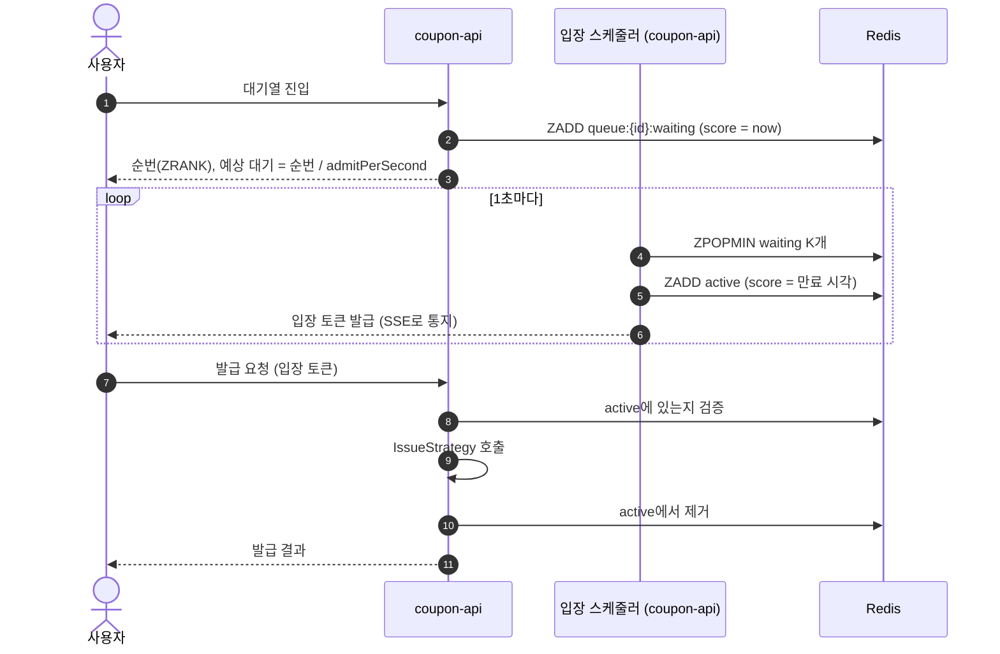

# 03. 발급 전략

모든 전략은 하나의 인터페이스로 구현하고, 이벤트 설정이나 요청 파라미터로 바꿔 끼웁니다.

```java
public interface IssueStrategy {
    StrategyType type();
    IssueResult issue(long eventId, long userId);   // ISSUED | SOLD_OUT | DUPLICATE | ACCEPTED(비동기) | ERROR
}
```

## 전략 목록

| # | 전략 | 핵심 아이디어 | 예상 결과 |
|---|---|---|---|
| 1 | `NAIVE` | 조회 → 확인 → 증가, 락 없음 | ❌ 초과 발급, 중복 발급 발생 (반면교사용) |
| 2 | `SYNCHRONIZED` | Java `synchronized` | ⚠️ 개발 모드(API 1대)에서는 통과. 실측 모드(API 2대)에서는 깨짐 |
| 3 | `DB_PESSIMISTIC` | `SELECT ... FOR UPDATE` | ✅ 정합성 보장. 행 락 경합으로 TPS 낮음 |
| 4 | `DB_OPTIMISTIC` | `@Version` + 재시도 | ✅ 정합성 보장. 경합이 심하면 재시도가 폭증해 오히려 느림 |
| 5 | `REDIS_LOCK` | Redisson 분산 락 안에서 DB 처리 | ✅ 정합성 보장. 다중 인스턴스 OK. 락 대기가 병목 |
| 6 | `REDIS_ATOMIC` | Lua 스크립트로 중복 체크와 재고 차감을 원자적으로, DB 저장은 동기 | ✅ 정합성 보장. 빠름 |
| 7 | `REDIS_KAFKA` | Redis에서 원자적으로 판정, Kafka로 넘기고 바로 응답, Consumer가 DB 저장 | ✅ 판정은 정확. 응답 가장 빠름. DB 반영은 늦음(최종 일관성) |

그리고 어느 전략에든 **대기열(Waiting Queue)** 을 앞단에 붙일 수 있습니다(`queueEnabled`).

---

## 1. NAIVE

```java
CouponEvent e = repo.findById(eventId);
if (issueRepo.existsByEventIdAndUserId(eventId, userId)) return DUPLICATE;
if (e.getIssuedQuantity() >= e.getTotalQuantity()) return SOLD_OUT;
e.increase();                       // issued_quantity + 1
issueRepo.save(new CouponIssue(eventId, userId));
```

여러 스레드가 동시에 "재고 있음"을 읽고 모두 통과합니다(Race condition, Lost update).

초과 발급 규모는 대략 **재고 × DB 커넥션 수**입니다. 커넥션 10개가 거의 같은 카운터 값을 읽고 각자 "읽은 값 + 1"을 덮어쓰기 때문에, 발급 10건마다 카운터가 1씩만 올라갑니다. 그래서 카운터가 100에 닿을 때까지 1,000건 가까이 발급됩니다(Phase 1·2 실측: 재고 100에 991~1,000장).
**이 전략에서 초과 발급이 실제로 나는 걸 보여주는 것이 프로젝트의 출발점입니다.**

## 2. SYNCHRONIZED

`synchronized` 메서드로 감쌉니다. 주의할 점이 있습니다. `@Transactional`과 같이 쓰면 **락이 풀린 다음에 커밋**되기 때문에 여전히 깨질 수 있습니다.
트랜잭션 바깥에서 락을 잡아야 합니다. 이 함정을 직접 보여주는 것도 학습 포인트입니다.

또 `synchronized`는 JVM 하나 안에서만 유효합니다. 실측 모드는 API를 2대 띄우기 때문에, 같은 코드가 **개발 모드에서는 통과하고 실측 모드에서는 초과 발급**이 나는 모습을 그대로 볼 수 있습니다.

## 3. DB_PESSIMISTIC

```java
@Lock(LockModeType.PESSIMISTIC_WRITE)
@Query("select e from CouponEvent e where e.id = :id")
Optional<CouponEvent> findByIdForUpdate(long id);
```

모든 요청이 이벤트 행 하나에 몰리기 때문에 사실상 직렬 처리됩니다. 커넥션 풀 고갈과 락 대기 타임아웃을 관찰할 수 있습니다.

## 4. DB_OPTIMISTIC

`@Version` 충돌(`ObjectOptimisticLockingFailureException`)이 나면 재시도합니다(최대 N회, 백오프).
지표에 **재시도 횟수**를 따로 집계해서, 경합이 심할 때 낙관적 락이 왜 불리한지 보여줍니다.

## 5. REDIS_LOCK

```java
RLock lock = redisson.getLock("lock:coupon:" + eventId);
if (!lock.tryLock(waitMs, leaseMs, MILLISECONDS)) return ERROR(LOCK_TIMEOUT);
try { /* NAIVE와 같은 로직 (트랜잭션은 락 안에서 시작하고 끝냄) */ }
finally { lock.unlock(); }
```

## 6. REDIS_ATOMIC (Lua)

```lua
-- KEYS[1] = coupon:{id}:issued, KEYS[2] = coupon:{id}:stock, ARGV[1] = userId
if redis.call('SISMEMBER', KEYS[1], ARGV[1]) == 1 then return -1 end  -- DUPLICATE
local stock = tonumber(redis.call('GET', KEYS[2]))
if stock <= 0 then return 0 end                                        -- SOLD_OUT
redis.call('DECR', KEYS[2])
redis.call('SADD', KEYS[1], ARGV[1])
return 1                                                               -- OK
```

판정에 통과하면 DB에 동기로 저장합니다. DB 저장이 실패하면 Redis를 보상 처리(`INCR` + `SREM`)합니다.

## 7. REDIS_KAFKA

1. Lua로 판정 (6번과 같음). 요청마다 `requestId`(UUID)를 만들어 멱등 키로 씁니다.
2. 통과하면 `coupon-issue` 토픽으로 produce하고, **브로커 ack를 받은 뒤에** `ACCEPTED` 응답
3. coupon-worker의 Consumer가 배치로 DB insert (멱등)

`ACCEPTED`는 "발급 확정, DB 반영은 곧"이라는 뜻입니다. Redis 판정과 Kafka 저장이 둘 다 끝났기 때문에 사용자에게 성공으로 보여줘도 되고, DB는 조금 늦게 따라옵니다(최종 일관성).

지표: API 응답 지연(매우 낮음), **Consumer lag**, **DB 반영 완료까지 걸린 시간**.
"사용자는 성공을 받았는데 DB에는 아직 없다"는 구간을 대시보드에서 볼 수 있게 합니다.

---

## 정합성 보장 장치

Redis, Kafka, DB를 함께 쓰면 **세 곳의 상태가 어긋나는 순간**이 생깁니다. 실무에서 가장 어려운 부분이라 단계마다 무엇이 실패할 수 있고 어떻게 처리하는지 정해 둡니다.

### 실패 지점별 처리

| # | 실패 지점 | 결과 | 처리 |
|---|---|---|---|
| F1 | Lua 실행 중 Redis 장애 | 판정 자체가 안 됨 | `ERROR` 응답. 상태 변화 없음 |
| F2 | Lua 통과 후 DB 저장 실패 (`REDIS_ATOMIC`) | Redis는 차감, DB는 없음 | Redis 보상(`INCR` + `SREM`) 후 `ERROR` 응답 |
| F3 | Lua 통과 후 Kafka 전송 실패·타임아웃 (`REDIS_KAFKA`) | Redis는 차감, 메시지 없음 | Redis 보상 후 `ERROR` 응답. 보상까지 실패하면 대사 배치가 바로잡음 |
| F4 | Consumer의 DB 저장 실패 | 메시지는 있음, DB는 없음 | 백오프 재시도 3회 → DLT로 이동 → DLT 재처리 |
| F5 | Consumer가 같은 메시지를 두 번 처리 (리밸런싱, 재시작) | 같은 insert가 중복 시도됨 | `UNIQUE` 제약 + `INSERT IGNORE`로 멱등 처리 |
| F6 | Redis 재시작으로 키 유실 | 재고와 발급 Set이 사라짐 | AOF로 예방. 그래도 유실되면 DB 기준으로 재적재 |

### Kafka 설정

| 구분 | 설정 | 이유 |
|---|---|---|
| Producer | `enable.idempotence=true`, `acks=all` | 재전송해도 브로커에 중복 저장되지 않음 |
| Producer | 전송 타임아웃(`delivery.timeout.ms`) 짧게 (예: 3초) | 사용자 응답이 오래 묶이지 않게 하고, 실패하면 F3 처리 |
| Consumer | 자동 커밋 끔, **DB 커밋 후 오프셋 커밋** | 처리하지 않은 메시지를 처리한 것으로 넘기지 않음 |
| Consumer | 배치 리스너 (예: 최대 500건) | insert를 묶어서 DB 부하 감소 |
| 에러 처리 | `DefaultErrorHandler` + 백오프 재시도 3회 → `coupon-issue.DLT` | 독성 메시지 하나가 파티션 전체를 막지 않게 함 |

### 대사(reconciliation) 배치

coupon-worker가 주기적으로(예: 이벤트 진행 중 30초마다, 종료 후 1회) Redis와 DB를 비교해서 맞춥니다.

| 상황 | 의미 | 처리 |
|---|---|---|
| Redis 발급 Set에만 있고 DB에 없음 | Kafka 처리 중이거나, F3·F4 실패 | Consumer lag이 0이고 DLT에도 없으면 유실로 판단 → DB에 보정 insert (또는 Redis 보상) |
| DB에만 있고 Redis에 없음 | Redis 키 유실(F6) 또는 버그 | Redis Set에 다시 추가하고 경고 로그 |
| `재고 키 ≠ 총 수량 - Set 크기` | 보상 처리 일부 실패 | 재고 키를 다시 계산해서 덮어씀 |

대사 결과(보정 건수)는 시뮬레이션 결과에 함께 기록해서, **장애가 있었을 때 무엇이 어떻게 복구됐는지** 대시보드에서 확인할 수 있게 합니다.

---

## 대기열 (Waiting Queue)

발급 전략과 별개로 앞단에 붙는 **유량 제어** 계층입니다. 정합성이 아니라 **서버 보호와 사용자 경험**을 위한 것입니다.



- 순번 알림은 **SSE push**를 기본으로 하고, 폴링 방식(`GET /rank`)도 같이 제공해서 비교할 수 있게 합니다.
- 재고가 소진되면 대기 중인 사용자 전원에게 `SOLD_OUT`을 일괄 통지하고 대기열을 비웁니다. 의미 없는 대기를 막기 위해서입니다.
- 입장 토큰은 TTL(예: 30초)이 있고, 만료되면 active에서 제거합니다.
