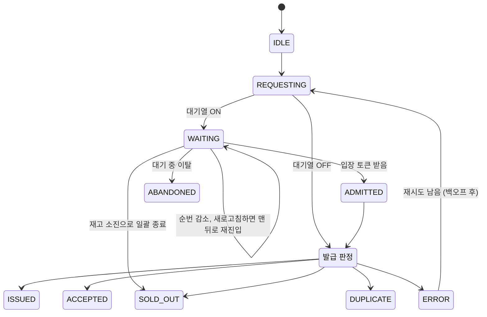

# 04. API & 실시간 이벤트 명세

| 서비스 | Base URL | 다루는 API |
|---|---|---|
| coupon-api (nginx 경유) | `http://localhost:8080/api` | 1~3장: 쿠폰 이벤트, 발급, 대기열 |
| simulator | `http://localhost:8090/api` | 4~5장: 시뮬레이션 실행, 실시간 스트림 |

사용자 식별은 인증 없이 `X-User-Id` 헤더로 합니다(시뮬레이터가 생성). 서명된 토큰으로 바꾸는 작업은 [확장 백로그](07-backlog.md)에 있습니다.

## 1. 쿠폰 이벤트

| Method | Path | 설명 |
|---|---|---|
| `POST` | `/events` | 이벤트 생성 |
| `GET` | `/events/{eventId}` | 이벤트 조회 (남은 재고 포함) |
| `POST` | `/events/{eventId}/reset` | 발급 이력, Redis 재고, 대기열 초기화 |
| `GET` | `/events/{eventId}/verification` | DB 기준 정합성 검증 결과 |

```jsonc
// POST /events
// name, totalQuantity, strategy만 필수. 나머지 기본값: queueEnabled=false, admitPerSecond=200, uniqueConstraintEnabled=true
{ "name": "11월 선착순 100장", "totalQuantity": 100,
  "strategy": "REDIS_ATOMIC", "queueEnabled": true, "admitPerSecond": 200,
  "uniqueConstraintEnabled": true }

// GET /events/{id}/verification
// issuedQuantityCounter: 이벤트의 발급 카운터. NAIVE에서는 갱신 손실 때문에 실제 발급 행 수보다 작게 남는다
{ "totalQuantity": 100, "issuedInDb": 137, "issuedQuantityCounter": 52,
  "overIssued": 37, "duplicateIssued": 12, "passed": false }
```

## 2. 발급

| Method | Path | 설명 |
|---|---|---|
| `POST` | `/events/{eventId}/issue` | 쿠폰 발급 요청 |

요청 헤더: `X-User-Id`, `X-Request-Id`(멱등 키, 재시도 시 같은 값, 선택), (대기열 사용 시) `X-Queue-Token`

**멱등 처리**: 중복으로 판정된 요청이라도, 같은 `X-Request-Id`로 이미 발급된 것이면 재시도로 보고 처음과 같은 `200 ISSUED`(`reason: "IDEMPOTENT_REPLAY"`)를 돌려줍니다. 클라이언트가 타임아웃으로 응답을 못 받았지만 서버는 발급한 경우, 재시도했을 때 "중복"이 아니라 "성공"을 보게 하기 위해서입니다. 요청 id가 다르면(연타) 그대로 `DUPLICATE`입니다.

응답 헤더: 어느 API 인스턴스가 처리했는지 `X-Served-By`(예: `coupon-api-2`, 개발 모드는 `coupon-api-local`). 부하 분산이 되는지 확인하는 용도이고, 모든 응답(Actuator 포함)에 붙습니다.

| HTTP | `result` | 의미 |
|---|---|---|
| 200 | `ISSUED` | 발급 성공 (동기 전략) |
| 202 | `ACCEPTED` | 발급 확정, DB 반영 대기 중 (`REDIS_KAFKA`) |
| 409 | `DUPLICATE` | 이미 발급받음 |
| 410 | `SOLD_OUT` | 재고 소진 |
| 403 | `NOT_ADMITTED` | 대기열 사용 이벤트인데 입장 토큰이 없거나, 다른 사용자 것이거나, 만료됨 |
| 503 | `ERROR` | `reason`: 분산 락 대기 초과(`LOCK_TIMEOUT`), 낙관적 락 재시도 초과(`OPTIMISTIC_RETRY_EXCEEDED`), Lua 판정 후 DB 저장 실패(`DB_SAVE_FAILED`, Redis는 되돌림), 인스턴스의 발급 처리 자리와 대기 줄이 모두 참(`OVERLOADED`, 바로 거절) |
| 500 | (ProblemDetail) | DB 커넥션을 `connection-timeout`(10초) 안에 못 받음 등 처리하지 못한 예외 |
| 400 | (ProblemDetail) | `X-User-Id` 헤더 없음, 아직 구현되지 않은 전략 |
| 404 | (ProblemDetail) | 이벤트 없음 |

`?strategy=DB_OPTIMISTIC`처럼 쿼리 파라미터를 주면 이벤트의 기본 전략 대신 그 전략으로 실행합니다.

```json
{ "result": "SOLD_OUT", "reason": null, "issuedAt": null }
```

## 3. 대기열

| Method | Path | 설명 |
|---|---|---|
| `POST` | `/events/{eventId}/queue` | 줄 서기. 이미 서 있으면 자리 그대로, 이미 입장했으면 입장 상태 |
| `GET` | `/events/{eventId}/queue/me` | 내 상태 조회 (폴링용) |
| `GET` | `/events/{eventId}/queue/me/stream` | 내 상태 SSE (push용). 대기가 끝나면(입장, 매진 등) 마지막 상태를 보내고 닫음 |
| `DELETE` | `/events/{eventId}/queue/me` | 대기 취소 (이탈). 새로고침은 취소 후 다시 줄 서기라 맨 뒤로 감 |

사용자는 `X-User-Id` 헤더로 구분합니다. 브라우저 `EventSource`는 헤더를 붙일 수 없어서 조회·SSE·취소는 `?userId=`도 받습니다 (실무라면 로그인 세션이나 쿠키). 대기열을 쓰지 않는 이벤트면 409입니다.

```jsonc
// 줄 서기 응답, queue/me 응답, queue/me/stream 의 각 이벤트(data)
{ "status": "WAITING", "rank": 3214, "totalWaiting": 8120, "estimatedWaitSec": 33 }   // rank는 내 순번(1부터), 내 앞에 rank-1명
{ "status": "ADMITTED", "token": "5f0c...e1", "expiresInSec": 30 }                   // 발급 요청에 X-Queue-Token으로
{ "status": "SOLD_OUT" }                                                             // 매진으로 대기열이 닫힘
{ "status": "EXPIRED" }                                                              // 입장했지만 토큰 시간 안에 발급하지 않음
{ "status": "NOT_IN_QUEUE" }                                                         // 줄을 선 적 없거나 취소함
```

- `estimatedWaitSec` = 순번 / 초당 입장 수. 이벤트를 만들 때 `admitPerSecond`(기본 200)로 정합니다.
- SSE는 남은 대기가 길수록 드물게 보냅니다(예상 대기의 10%, 1~5초). 입장·매진은 바로 보냅니다.

## 4. 시뮬레이션

| Method | Path | 설명 |
|---|---|---|
| `POST` | `/simulations` | 시뮬레이션 시작 → 202 `{ runId, eventId }` |
| `GET` | `/simulations?limit=50` | 실행 기록 목록 (최근 것부터, 최대 200) |
| `GET` | `/simulations/{runId}` | 설정과 결과 요약 |
| `POST` | `/simulations/{runId}/stop` | 중단 |
| `GET` | `/simulations/{runId}/stream` | **실시간 SSE** |
| `GET` | `/simulations/{runId}/users/{userId}` | 사용자 한 명의 타임라인 |
| `GET` | `/simulations/compare?ids=1,2,3` | 실행끼리 비교. 요약 + 1초 단위 시계열(`series`), `ids` 순서대로 |
| `DELETE` | `/simulations/{runId}` | 실행 기록 삭제 (실행 중이면 409) |

실행 기록은 simulator의 `simulation` DB에 남습니다. 시작할 때 `RUNNING`으로 한 행을 만들고(이 id가 `runId`), 끝나면 결과와 사용자별 결과를 저장합니다. simulator가 실행 도중 내려가면 다음에 뜰 때 그 실행을 `FAILED`로 바꿉니다.
실시간 상태(SSE 구독, 진행 중인 사용자 상태)는 최근 20개 실행만 메모리에 두고, 그보다 오래된 실행의 사용자 타임라인은 DB에서 읽습니다.

```jsonc
// GET /simulations, GET /simulations/{runId} 의 원소
{ "runId": 2, "eventId": 13, "strategy": "DB_PESSIMISTIC", "userCount": 5000, "stock": 100, "rampUpMs": 0,
  "behaviorPreset": "IDEAL", "queueEnabled": false, "targetBaseUrl": "http://localhost:8080",
  "state": "DONE", "startedAt": "...", "finishedAt": "...", "durationMs": 11699, "avgTps": 427,
  "latencyMs": { "p50": 6791.2, "p95": 11173.9, "p99": 11534.3, "max": 11657.2 },
  "verification": { "issuedInDb": 100, "overIssued": 0, "duplicateIssued": 0, "passed": true, "...": 0 },
  "counts": { "ISSUED": 100, "SOLD_OUT": 4900, "...": 0 }, "error": null }

// GET /simulations/compare?ids=2,1
[ { "summary": { /* 위와 같음 */ }, "series": [ { "t": 1007, "tps": 38, "latencyMs": { "p50": 677.9, "...": 0 }, "queueLength": 0 } ] } ]
```

```jsonc
// POST /simulations
{
  "eventId": 1,                 // 없으면 아래 설정으로 이벤트 자동 생성
  "stock": 100,
  "strategy": "DB_PESSIMISTIC",
  "queueEnabled": false,        // true면 이벤트를 대기열 사용으로 만든다. 사용자는 줄을 서고 입장한 뒤 발급 요청
  "admitPerSecond": 200,        // 대기열 초당 입장 수 (기본 200)
  "userCount": 5000,
  "rampUpMs": 0,                // 0 = 모두 동시에 출발 (CountDownLatch)
  "queueNotifyMode": "SSE",     // SSE | POLLING. 대기 중 순번을 받는 방법
  "trackedUserLimit": 2000,     // 개별 상태를 스트리밍할 최대 사용자 수 (미구현)
  "behavior": {                 // 사용자 행동 모델. preset만 주면 나머지는 프리셋 값, 준 항목만 덮어씀
    "preset": "REALISTIC",      // IDEAL | REALISTIC | AGGRESSIVE
    "thinkTimeMs": [0, 300],    // 버튼 누르기까지 걸리는 시간 (균등분포 범위)
    "multiClick": { "ratio": 0.2, "clicks": 3 },          // 20%가 3번 연타 (클릭 간격 100ms, 클릭마다 다른 요청 id)
    "retry": { "maxRetries": 2, "backoffMs": 500, "jitter": true },  // 에러면 같은 요청 id로 재시도. 백오프는 시도마다 2배
    "timeoutMs": 10000,         // 클라이언트가 응답을 기다리는 최대 시간. 넘기면 포기하고 에러(TIMEOUT)
    "refreshWhileWaiting": { "ratePerMinute": 0.1 },      // 대기 중 새로고침: 줄에서 나갔다가 맨 뒤로 다시 섬 (지수분포)
    "abandon": { "medianWaitSec": 60 },                   // 이만큼 기다리면 절반이 떠남 (0이면 이탈 없음)
    "polling": { "intervalMs": 1000, "jitterMs": 300 }    // 폴링 모드의 확인 간격 ± 흔들림
  }
}
```

| 항목 | `IDEAL` | `REALISTIC` | `AGGRESSIVE` |
|---|---|---|---|
| 생각 시간 | 0 | 0~300ms | 0 |
| 연타 | 없음 | 20%가 3번 | 50%가 3번 |
| 재시도 | 없음 | 2회, 백오프 500ms(지수) + 지터 | 3회, 백오프 없음 |
| 타임아웃 | 30초 | 10초 | 3초 |
| 새로고침 (대기 중) | 없음 | 분당 0.1회 | 분당 0.5회 |
| 이탈 (대기 중) | 없음 | 대기 중앙값 60초 | 없음 (끝까지 버팀) |
| 폴링 간격 | 1초 | 1초 ± 0.3초 | 1초 ± 0.3초 |

`AGGRESSIVE`는 처음에 60%가 5번 연타, 즉시 재시도 5회로 시작했습니다. 그 설정에서는 동시 요청이 1만 7천 개를 넘어서 nginx와 부하 생성기 자체가 먼저 무너져, 전략 비교가 아니라 인프라 붕괴만 보였습니다. 그래서 폭주는 일어나되 측정은 되는 수준으로 낮췄습니다 ([06 Phase 4 결과](06-roadmap.md#phase-4-redis-전략--사용자-행동-모델)).

**대기열을 쓰는 가상 사용자**: 생각 시간 → 줄 서기 → 순번을 받으며 대기(SSE 또는 폴링) → 입장하면 발급 버튼(연타·재시도 규칙은 같음). 기다리는 동안 새로고침 시점이 오면 줄에서 나갔다가 다시 서고, 참을성이 다하면 떠납니다(`ABANDONED`). 줄 서기·순번 확인이 실패하면 발급과 같은 재시도 규칙(횟수, 백오프, 최소 100ms)을 따릅니다. 기존 이벤트(`eventId`)를 다시 쓰면 대기열 여부는 요청이 아니라 그 이벤트 설정을 따릅니다.

**구현 현황**: `trackedUserLimit`은 아직 없음(사용자 1만 명까지는 전부 스트리밍).

| 상황 | 응답 |
|---|---|
| 구현 전 옵션, 행동 모델 값이 범위 밖, `eventId`도 `stock`도 없음 | 400 ProblemDetail |
| 이벤트 생성·초기화를 위한 coupon-api 호출 실패 | 502 ProblemDetail |
| 없는 runId | 404 ProblemDetail |

## 5. 실시간 SSE 이벤트 포맷 (`/simulations/{runId}/stream`)

사용자 1만 명의 상태 변화를 하나하나 보내면 브라우저가 감당하지 못하므로, **200ms 단위로 묶어서** 보냅니다.

### `init`: 구독 직후 한 번
```json
{ "runId": 3, "eventId": 7, "strategy": "NAIVE", "stock": 100, "userCount": 5000, "state": "RUNNING", "t": 1200 }
```
`init` 바로 다음에 지금까지의 사용자 상태 전체를 `users` 이벤트 하나로 보냅니다. 그래서 늦게 구독하거나 연결이 끊겨 재연결해도 화면을 그대로 복원할 수 있습니다. 이미 끝난 실행을 구독하면 `done`까지 보내고 연결을 닫습니다.

### `tick`: 집계 지표 (200ms마다)
```json
{
  "t": 3200,
  "stockLeft": 12,
  "counts": { "IDLE": 0, "REQUESTING": 310, "WAITING": 4100, "ADMITTED": 40,
              "ISSUED": 88, "SOLD_OUT": 450, "DUPLICATE": 0, "ERROR": 12, "ABANDONED": 3 },
  "tps": 1840,
  "latencyMs": { "p50": 12, "p95": 85, "p99": 230 },
  "queueLength": 4100,
  "retries": 37,
  "requests": 6120,
  "responses": { "ISSUED": 88, "SOLD_OUT": 450, "DUPLICATE": 31, "ERROR": 49 },
  "kafkaLag": 0,
  "servedBy": { "coupon-api-1": 921, "coupon-api-2": 919 },
  "server": {
    "coupon-api-1": { "hikariActive": 10, "hikariPending": 412, "cpuPercent": 87.5, "heapUsedMb": 640 },
    "coupon-api-2": { "hikariActive": 10, "hikariPending": 398, "cpuPercent": 91.2, "heapUsedMb": 612 }
  }
}
```
- `counts`는 **사용자** 단위(현재 상태), `tps`·`latencyMs`·`requests`·`responses`는 **요청** 단위(연타·재시도 포함)입니다. 연타한 사용자는 응답이 여러 개(예: 발급 1 + 중복 2)지만 최종 상태는 하나(발급)입니다.
- `tps`는 최근 1초 동안 끝난 요청 수, `latencyMs`는 **이번 200ms 구간에 끝난 요청**의 분포입니다. 구간에 끝난 요청이 없으면 값이 `null`입니다.
- `stockLeft`는 simulator가 받은 성공 응답 기준입니다. 실제 판정은 `done`의 DB 검증으로 합니다.
- `servedBy`는 인스턴스별 누적 응답 수(`X-Served-By` 기준)입니다.
- `server`는 인스턴스별 최근 서버 지표입니다. simulator가 실행 중에 1초마다 각 인스턴스의 Actuator(`hikaricp.connections.active`, `hikaricp.connections.pending`, `process.cpu.usage`, `jvm.memory.used`의 heap)를 로드밸런서를 거치지 않고 직접 읽습니다. 읽을 주소는 `SERVER_METRICS_URLS`로 정합니다. `cpuPercent`는 컨테이너에 할당된 CPU 기준이고, `heapUsedMb`는 GC 전 쓰레기를 포함한 사용 중 힙입니다(Phase 5부터, 대기열 SSE 연결의 메모리 비용을 보려고).
- `queueLength`는 지금 줄에 서 있는 가상 사용자 수(`counts.WAITING`)입니다. 대기열을 쓰지 않으면 0입니다.
- `kafkaLag`은 Phase 6부터 들어갑니다.

### `users`: 사용자 상태 변경분 (200ms마다, 바뀐 사용자만)
```json
{ "changes": [ [17, "WAITING", 3214, 1], [18, "ISSUED", null, 3], [19, "SOLD_OUT", null, 1] ] }
```
배열 형식 `[userId, status, rank, attempts]`으로 보내서 크기를 줄입니다. `attempts`는 그 사용자가 보낸 요청 수(연타·재시도 포함)입니다. `userId`는 실행마다 1부터 매기고, 같은 구간에 상태가 여러 번 바뀌면 마지막 상태만 보냅니다. `rank`는 줄에 서 있는 동안의 내 순번이고, 순번이 바뀌어도 이 이벤트로 옵니다(타임라인에는 줄 선 순간과 입장만 남김). `trackedUserLimit`을 넘는 사용자는 집계에만 반영됩니다.

### `done`: 종료 + 최종 결과
```json
{ "state": "DONE", "durationMs": 8123, "counts": { "ISSUED": 100, "SOLD_OUT": 4900, "...": 0 }, "error": null,
  "verification": { "issuedInDb": 100, "overIssued": 0, "duplicateIssued": 0, "passed": true },
  "reconciliation": { "insertedToDb": 0, "restoredToRedis": 0, "stockRecomputed": false },
  "latencyMs": { "p50": 14, "p95": 90, "p99": 260, "max": 1203 }, "avgTps": 615,
  "queue": { "enters": 10291, "polls": 0, "refreshes": 291, "abandoned": 2300, "admitted": 3045, "errors": 0,
             "waitMs": { "p50": 15515.6, "p95": 28475.4, "p99": 29556.7, "max": 31244.3 },
             "admitPerSecond": 100, "notifyMode": "SSE" } }
```
- `queue`는 대기열을 쓴 실행만 있습니다. `enters`는 줄 서기 요청 수(새로고침으로 다시 선 것 포함), `polls`는 폴링 요청 수(SSE면 0), `errors`는 줄 서기·순번 확인 실패 수, `waitMs`는 줄 선 뒤 입장까지 걸린 시간입니다. `latencyMs`·`avgTps`는 발급 요청만 셉니다.
- `state`가 `STOPPED`면 중단된 실행입니다. 중단하면 요청 중이던 사용자는 `ERROR`(`STOPPED`)가 되지만, 서버는 이미 받은 요청을 끝까지 처리하므로 DB 발급 수가 화면의 성공 수보다 클 수 있습니다.
- `servedBy`는 인스턴스별 최종 응답 수, `serverPeak`는 인스턴스별 실행 중 최댓값(커넥션 사용·대기 수, CPU)입니다.
- `requests`·`retries`는 전체 요청·재시도 수, `responses`는 응답 결과별 수, `errors`는 에러 사유별 수(`LOCK_TIMEOUT`, 클라이언트 `TIMEOUT`, `CONNECT_TIMEOUT` 등)입니다.
- `verification`의 `redisStock`·`redisIssuedUsers`는 Redis 쪽 남은 재고와 발급 Set 크기입니다. `REDIS_ATOMIC`이면 `redisIssuedUsers = issuedInDb`여야 합니다.
- `verification`을 가져오지 못하면 `null`이고 `error`에 이유가 들어갑니다. `reconciliation`은 Phase 6부터 들어갑니다.

## 6. 가상 사용자 상태 머신



`ISSUED`, `ACCEPTED`, `SOLD_OUT`, `DUPLICATE`, `ABANDONED`는 최종 상태이고, `ERROR`는 재시도가 남아 있지 않으면 최종 상태가 됩니다.

재시도는 별도 상태로 두지 않고 `REQUESTING`으로 돌아갑니다. 사용자 타임라인에는 몇 번째 시도인지(`attempt`)를 함께 기록합니다.
