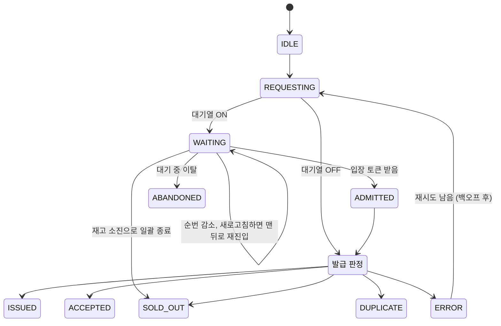

# 04. API & 실시간 이벤트 명세

| 서비스 | Base URL | 다루는 API |
|---|---|---|
| coupon-api (nginx 경유) | `http://localhost:8080/api` | 1~3장: 쿠폰 이벤트, 발급, 대기열 |
| simulator | `http://localhost:8090/api` | 4~5장: 시뮬레이션 실행, 실시간 스트림 |

사용자 식별은 인증 없이 `X-User-Id` 헤더로 합니다(시뮬레이터가 생성). 서명된 토큰으로 바꾸는 작업은 [확장 백로그](07-backlog.md)에 있습니다.

## 1. 쿠폰 이벤트

| Method | Path | 설명 |
|---|---|---|
| `POST` | `/events` | 이벤트 생성 |
| `GET` | `/events/{eventId}` | 이벤트 조회 (남은 재고 포함) |
| `POST` | `/events/{eventId}/reset` | 발급 이력, Redis 재고, 대기열 초기화 |
| `GET` | `/events/{eventId}/verification` | DB 기준 정합성 검증 결과 |

```jsonc
// POST /events
// name, totalQuantity, strategy만 필수. 나머지 기본값: queueEnabled=false, admitPerSecond=200, uniqueConstraintEnabled=true
{ "name": "11월 선착순 100장", "totalQuantity": 100,
  "strategy": "REDIS_ATOMIC", "queueEnabled": true, "admitPerSecond": 200,
  "uniqueConstraintEnabled": true }

// GET /events/{id}/verification
// issuedQuantityCounter: 이벤트의 발급 카운터. NAIVE에서는 갱신 손실 때문에 실제 발급 행 수보다 작게 남는다
{ "totalQuantity": 100, "issuedInDb": 137, "issuedQuantityCounter": 52,
  "overIssued": 37, "duplicateIssued": 12, "passed": false }
```

## 2. 발급

| Method | Path | 설명 |
|---|---|---|
| `POST` | `/events/{eventId}/issue` | 쿠폰 발급 요청 |

요청 헤더: `X-User-Id`, `X-Request-Id`(멱등 키, 재시도 시 같은 값), (대기열 사용 시) `X-Queue-Token`

응답 헤더: 어느 API 인스턴스가 처리했는지 `X-Served-By`(예: `coupon-api-2`). 부하 분산이 되는지 확인하는 용도입니다.

| HTTP | `result` | 의미 |
|---|---|---|
| 200 | `ISSUED` | 발급 성공 (동기 전략) |
| 202 | `ACCEPTED` | 발급 확정, DB 반영 대기 중 (`REDIS_KAFKA`) |
| 409 | `DUPLICATE` | 이미 발급받음 |
| 410 | `SOLD_OUT` | 재고 소진 |
| 403 | `NOT_ADMITTED` | 대기열 사용 이벤트인데 입장 토큰이 없거나 만료됨 |
| 503 | `ERROR` | 락 타임아웃, 낙관적 락 재시도 초과(`OPTIMISTIC_RETRY_EXCEEDED`) 등 (`reason` 필드 포함) |
| 400 | (ProblemDetail) | `X-User-Id` 헤더 없음, 아직 구현되지 않은 전략 |
| 404 | (ProblemDetail) | 이벤트 없음 |

`?strategy=DB_OPTIMISTIC`처럼 쿼리 파라미터를 주면 이벤트의 기본 전략 대신 그 전략으로 실행합니다.

```json
{ "result": "SOLD_OUT", "reason": null, "issuedAt": null }
```

## 3. 대기열

| Method | Path | 설명 |
|---|---|---|
| `POST` | `/events/{eventId}/queue` | 대기열 진입 → `{ rank, estimatedWaitSec }` |
| `GET` | `/events/{eventId}/queue/me` | 내 상태 조회 (폴링용) |
| `GET` | `/events/{eventId}/queue/me/stream` | 내 상태 SSE (push용) |
| `DELETE` | `/events/{eventId}/queue/me` | 대기 취소 (이탈) |

```jsonc
// queue/me 응답, 또는 queue/me/stream 의 각 이벤트
{ "status": "WAITING", "rank": 3214, "totalWaiting": 8120, "estimatedWaitSec": 16 }
{ "status": "ADMITTED", "token": "q_7f3a...", "expiresInSec": 30 }
{ "status": "SOLD_OUT" }
```

## 4. 시뮬레이션

| Method | Path | 설명 |
|---|---|---|
| `POST` | `/simulations` | 시뮬레이션 시작 → 202 `{ runId, eventId }` |
| `GET` | `/simulations?limit=50` | 실행 기록 목록 (최근 것부터, 최대 200) |
| `GET` | `/simulations/{runId}` | 설정과 결과 요약 |
| `POST` | `/simulations/{runId}/stop` | 중단 |
| `GET` | `/simulations/{runId}/stream` | **실시간 SSE** |
| `GET` | `/simulations/{runId}/users/{userId}` | 사용자 한 명의 타임라인 |
| `GET` | `/simulations/compare?ids=1,2,3` | 실행끼리 비교. 요약 + 1초 단위 시계열(`series`), `ids` 순서대로 |
| `DELETE` | `/simulations/{runId}` | 실행 기록 삭제 (실행 중이면 409) |

실행 기록은 simulator의 `simulation` DB에 남습니다. 시작할 때 `RUNNING`으로 한 행을 만들고(이 id가 `runId`), 끝나면 결과와 사용자별 결과를 저장합니다. simulator가 실행 도중 내려가면 다음에 뜰 때 그 실행을 `FAILED`로 바꿉니다.
실시간 상태(SSE 구독, 진행 중인 사용자 상태)는 최근 20개 실행만 메모리에 두고, 그보다 오래된 실행의 사용자 타임라인은 DB에서 읽습니다.

```jsonc
// GET /simulations, GET /simulations/{runId} 의 원소
{ "runId": 2, "eventId": 13, "strategy": "DB_PESSIMISTIC", "userCount": 5000, "stock": 100, "rampUpMs": 0,
  "behaviorPreset": "IDEAL", "queueEnabled": false, "targetBaseUrl": "http://localhost:8080",
  "state": "DONE", "startedAt": "...", "finishedAt": "...", "durationMs": 11699, "avgTps": 427,
  "latencyMs": { "p50": 6791.2, "p95": 11173.9, "p99": 11534.3, "max": 11657.2 },
  "verification": { "issuedInDb": 100, "overIssued": 0, "duplicateIssued": 0, "passed": true, "...": 0 },
  "counts": { "ISSUED": 100, "SOLD_OUT": 4900, "...": 0 }, "error": null }

// GET /simulations/compare?ids=2,1
[ { "summary": { /* 위와 같음 */ }, "series": [ { "t": 1007, "tps": 38, "latencyMs": { "p50": 677.9, "...": 0 }, "queueLength": 0 } ] } ]
```

```jsonc
// POST /simulations
{
  "eventId": 1,                 // 없으면 아래 설정으로 이벤트 자동 생성
  "stock": 100,
  "strategy": "DB_PESSIMISTIC",
  "queueEnabled": false,
  "userCount": 5000,
  "rampUpMs": 0,                // 0 = 모두 동시에 출발 (CountDownLatch)
  "queueNotifyMode": "SSE",     // SSE | POLLING
  "trackedUserLimit": 2000,     // 개별 상태를 스트리밍할 최대 사용자 수
  "behavior": {                 // 사용자 행동 모델. preset만 주면 나머지는 프리셋 값
    "preset": "REALISTIC",      // IDEAL | REALISTIC | AGGRESSIVE
    "thinkTimeMs": [0, 300],    // 버튼 누르기까지 걸리는 시간 (균등분포 범위)
    "multiClick": { "ratio": 0.2, "clicks": 3 },          // 20%가 3번 연타
    "retry": { "maxRetries": 2, "backoffMs": 500, "jitter": true },
    "refreshWhileWaiting": { "ratePerMinute": 0.1 },      // 대기 중 새로고침 (순번 뒤로)
    "abandon": { "medianWaitSec": 60 },                   // 대기 시간이 길수록 이탈 확률 증가
    "polling": { "intervalMs": 1000, "jitterMs": 300 }
  }
}
```

| 항목 | `IDEAL` | `REALISTIC` | `AGGRESSIVE` |
|---|---|---|---|
| 연타 | 없음 | 20%가 3번 | 60%가 5번 |
| 재시도 | 없음 | 2회, 백오프 500ms + 지터 | 5회, 백오프 없음 |
| 새로고침 | 없음 | 분당 0.1회 | 분당 0.5회 |
| 이탈 | 없음 | 대기 중앙값 60초 | 없음 (끝까지 버팀) |

**구현 현황**: 지금은 `behavior.preset`이 `IDEAL`(또는 생략)이고 `queueEnabled`가 `false`인 경우만 받습니다. 아직 없는 기능을 요청하면 조용히 무시하지 않고 400을 돌려줍니다. 행동 모델 세부 값은 Phase 4, 대기열·`queueNotifyMode`는 Phase 5, `trackedUserLimit`은 아직 없음(사용자 1만 명까지는 전부 스트리밍).

| 상황 | 응답 |
|---|---|
| 구현 전 옵션, `eventId`도 `stock`도 없음 | 400 ProblemDetail |
| 이벤트 생성·초기화를 위한 coupon-api 호출 실패 | 502 ProblemDetail |
| 없는 runId | 404 ProblemDetail |

## 5. 실시간 SSE 이벤트 포맷 (`/simulations/{runId}/stream`)

사용자 1만 명의 상태 변화를 하나하나 보내면 브라우저가 감당하지 못하므로, **200ms 단위로 묶어서** 보냅니다.

### `init`: 구독 직후 한 번
```json
{ "runId": 3, "eventId": 7, "strategy": "NAIVE", "stock": 100, "userCount": 5000, "state": "RUNNING", "t": 1200 }
```
`init` 바로 다음에 지금까지의 사용자 상태 전체를 `users` 이벤트 하나로 보냅니다. 그래서 늦게 구독하거나 연결이 끊겨 재연결해도 화면을 그대로 복원할 수 있습니다. 이미 끝난 실행을 구독하면 `done`까지 보내고 연결을 닫습니다.

### `tick`: 집계 지표 (200ms마다)
```json
{
  "t": 3200,
  "stockLeft": 12,
  "counts": { "IDLE": 0, "REQUESTING": 310, "WAITING": 4100, "ADMITTED": 40,
              "ISSUED": 88, "SOLD_OUT": 450, "DUPLICATE": 0, "ERROR": 12, "ABANDONED": 3 },
  "tps": 1840,
  "latencyMs": { "p50": 12, "p95": 85, "p99": 230 },
  "queueLength": 4100,
  "retries": 37,
  "kafkaLag": 0,
  "servedBy": { "coupon-api-1": 921, "coupon-api-2": 919 },
  "server": { "hikariPending": 4, "hikariActive": 10 }
}
```
- `tps`는 최근 1초 동안 끝난 요청 수, `latencyMs`는 **이번 200ms 구간에 끝난 요청**의 분포입니다. 구간에 끝난 요청이 없으면 값이 `null`입니다.
- `stockLeft`는 simulator가 받은 성공 응답 기준입니다. 실제 판정은 `done`의 DB 검증으로 합니다.
- `servedBy`, `server`는 Phase 3, `kafkaLag`은 Phase 6부터 들어갑니다. `queueLength`, `retries`는 해당 기능 전까지 0입니다.

### `users`: 사용자 상태 변경분 (200ms마다, 바뀐 사용자만)
```json
{ "changes": [ [17, "WAITING", 3214], [18, "ISSUED"], [19, "SOLD_OUT"] ] }
```
배열 형식 `[userId, status, rank?]`으로 보내서 크기를 줄입니다. `userId`는 실행마다 1부터 매기고, 같은 구간에 상태가 여러 번 바뀌면 마지막 상태만 보냅니다. `rank`는 대기열(Phase 5)부터 붙습니다. `trackedUserLimit`을 넘는 사용자는 집계에만 반영됩니다.

### `done`: 종료 + 최종 결과
```json
{ "state": "DONE", "durationMs": 8123, "counts": { "ISSUED": 100, "SOLD_OUT": 4900, "...": 0 }, "error": null,
  "verification": { "issuedInDb": 100, "overIssued": 0, "duplicateIssued": 0, "passed": true },
  "reconciliation": { "insertedToDb": 0, "restoredToRedis": 0, "stockRecomputed": false },
  "latencyMs": { "p50": 14, "p95": 90, "p99": 260, "max": 1203 }, "avgTps": 615 }
```
- `state`가 `STOPPED`면 중단된 실행입니다. 중단하면 요청 중이던 사용자는 `ERROR`(`STOPPED`)가 되지만, 서버는 이미 받은 요청을 끝까지 처리하므로 DB 발급 수가 화면의 성공 수보다 클 수 있습니다.
- `verification`을 가져오지 못하면 `null`이고 `error`에 이유가 들어갑니다. `reconciliation`은 Phase 6부터 들어갑니다.

## 6. 가상 사용자 상태 머신



`ISSUED`, `ACCEPTED`, `SOLD_OUT`, `DUPLICATE`, `ABANDONED`는 최종 상태이고, `ERROR`는 재시도가 남아 있지 않으면 최종 상태가 됩니다.

재시도는 별도 상태로 두지 않고 `REQUESTING`으로 돌아갑니다. 사용자 타임라인에는 몇 번째 시도인지(`attempt`)를 함께 기록합니다.
